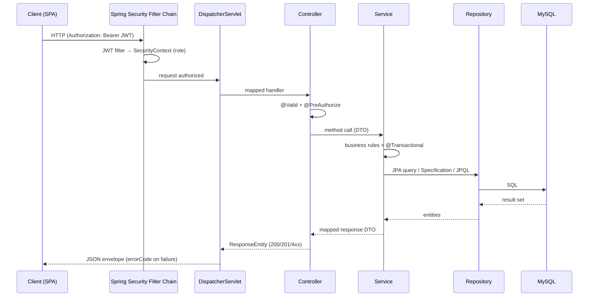
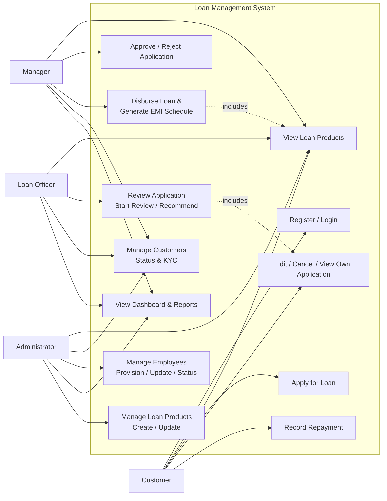

# Software Requirements Specification (SRS)

## APSFC Land Development Bank — Loan Management System

| Item | Detail |
|---|---|
| **Document Title** | Software Requirements Specification — APSFC Loan Management System |
| **Version** | 1.0 |
| **Status** | Approved (implemented & verified end-to-end) |
| **Prepared by** | Senior Software Engineer |
| **Date** | 18-Sep-2026 |
| **Compliance** | IEEE 830-style structure; IEEE 29148 / ISO/IEC/IEEE 12207 concepts applied |

---

## Table of Contents

1. [Introduction](#1-introduction)
2. [Overall Description](#2-overall-description)
3. [Functional Requirements & Use Cases](#3-functional-requirements--use-cases)
4. [Use Case Specifications](#4-use-case-specifications)
5. [Non-Functional Requirements](#5-non-functional-requirements)
6. [Business Rules](#6-business-rules)
7. [Data Requirements](#7-data-requirements)
8. [Security & Role-Based Access Control](#8-security--role-based-access-control)
9. [API Requirements](#9-api-requirements)
10. [Frontend / UI Requirements](#10-frontend--ui-requirements)
11. [Acceptance & Verification](#11-acceptance--verification)
12. [Appendix](#12-appendix)

---

## 1. Introduction

### 1.1 Purpose
The purpose of this document is to define the complete functional and non-functional requirements of the **APSFC Loan Management System** — a web application that automates the **loan origination and servicing lifecycle**: from a customer applying for a loan, through staff verification, manager approval/disbursement, EMI scheduling, collections and loan closure — with a **role-based access control** (RBAC) model, full **audit trail**, and **portfolio reporting**.

### 1.2 Scope
**In scope:**
- Customer self-registration and KYC profile management
- Configurable loan product catalogue
- Loan application workflow with formal state machine (`DRAFT → SUBMITTED → UNDER_REVIEW → APPROVED/REJECTED → DISBURSED/CANCELLED`)
- Loan disbursement with auto-generated amortization (EMI) schedule
- Installment-wise repayment processing with strict in-order settlement and auto loan closure
- Staff administration (employees), customer lifecycle (activate/deactivate, KYC verification)
- Executive dashboard and reports (portfolio, upcoming/overdue EMIs, collections)
- JWT-based authentication and method-level RBAC
- Responsive single-page web frontend

**Out of scope (future):**
- Payment gateway integration, document upload, credit-score integration, notifications via SMS/email, penalty/late-fee engine, RBI reporting exports.

### 1.3 Definitions, Acronyms & Abbreviations
| Term | Meaning |
|---|---|
| APSFC | Andhra Pradesh State Financial Corporation |
| SRS | Software Requirements Specification |
| KYC | Know Your Customer |
| EMI | Equated Monthly Installment |
| RBAC | Role-Based Access Control |
| JWT | JSON Web Token |
| JPA | Jakarta Persistence API |
| MGR | Manager |
| OFF | Loan Officer |
| ADM | Administrator |
| CUST | Customer |

### 1.4 References
- IEEE Std 830-1998 — IEEE Recommended Practice for SRS
- ISO/IEC/IEEE 29148:2018 — Requirements engineering
- Market-standard loan money-math: **Reducing Balance Amortization**

### 1.5 Intended Audience
Business analysts, developers, testers, DevOps, and interviewees presenting the system.

---

## 2. Overall Description

### 2.1 Product Perspective
Standalone web application consisting of:
1. **Backend** — Java 17, Spring Boot 3.5, Spring Security (JWT), Spring Data JPA, MySQL 8.0, Flyway migrations, OpenAPI.
2. **Frontend** — Vanilla HTML/CSS/JS SPA (hash router), served from `:5500`, consuming REST APIs at `:8080` (CORS-enabled).

### 2.2 Product Functions (Summary)
| # | Function | Primary Actors |
|---|---|---|
| F1 | Customer self-registration (creates User + KYC) | CUST |
| F2 | Authentication & profile (`login`, `/me`, JWT issuance) | all |
| F3 | Loan product catalogue (create/view/update) | ADM (manage), all (view) |
| F4 | Loan application lifecycle (create/submit/edit/cancel/history) | CUST |
| F5 | Loan application review (start review / recommend / approve / reject) | OFF, MGR |
| F6 | Loan disbursement + EMI schedule generation | MGR |
| F7 | Repayment recording (next unpaid EMI only) & history | CUST, staff |
| F8 | Customer management (list/search, status, KYC verify) | OFF, MGR, ADM |
| F9 | Employee administration (provision/update/status) | ADM |
| F10 | Dashboard summary & portfolio reports | staff |

### 2.3 User Classes & Roles
| Role | Description | Sample |
|---|---|---|
| **CUSTOMER** | Registers online; applies, edits drafts, submits, cancels, views own applications/loans/EMIs/payments, records own repayments | Borrowers |
| **LOAN_OFFICER** | Verification & review queue; advisory recommend; views customers, loans, repayments, reports | Operations staff |
| **MANAGER** | Final approval/rejection, disbursement, customer status/KYC actions | Branch/sanctioning authority |
| **ADMIN** | Full read visibility; product and employee administration; customer actions | IT/super admin |

> Every user has **exactly one role** (`Role` enum: `CUSTOMER`, `LOAN_OFFICER`, `MANAGER`, `ADMIN`).

### 2.4 Operating Environment
| Component | Specification |
|---|---|
| Runtime (backend) | Java 17+ (JDK 24.0.1 verified), Spring Boot 3.5.16 |
| Database | MySQL 8.0.43, schema `apsfc_lms`, user `apsfc_user` |
| Build | Maven 3.9.16 |
| Frontend | Any modern browser (Chrome/Edge/Firefox) |
| Ports | Dev API `8080`, SPA `5500` |

### 2.5 Design & Implementation Constraints
- **Money** must use `BigDecimal` (`DECIMAL(19,2)`, `HALF_EVEN` rounding) — never `double`.
- All application-status changes **must** pass through `ApplicationStateMachine`.
- DB schema is managed by **Flyway migrations** (`V1…V12`); `ddl-auto: validate`.
- No framework on the frontend; all HTTP via a thin `fetch` wrapper.
- Restrictive method-level authorization (`@PreAuthorize`) layered with service-level ownership checks.

### 2.6 Assumptions & Dependencies
- Single-role users; one loan product selected per application; flat (fixed) interest rate at application time.
- Repayment applies to the *next unpaid installment only* (overpayment is rejected, not credited).
- Manager decisions and disbursements are synchronous HTTP operations (no async queue).

---

### 2.7 Project Architecture (Detailed)

#### 2.7.1 Architecture Overview
The system is a **three-tier application**: a static single-page frontend, a RESTful Spring Boot backend, and a relational database — separated so the API layer is fully reusable (mobile clients, integrations) and the presentation tier stays independently deployable.

```mermaid
flowchart LR
    subgraph Presentation["Presentation Tier (:5500)"]
        A[Vanilla JS SPA<br/>Hash Router <b>app.js</b>]
    end
    subgraph API["Application Tier (:8080)"]
        B[Spring Boot 3.5]
        B1[Controllers<br/>REST + DTO]
        B2[Services<br/>State Machine / Money Logic]
        B3[Repositories<br/>JPA + Specifications]
    end
    subgraph Data["Data Tier"]
        C[(MySQL 8.0<br/>apsfc_lms)]
        D[Flyway<br/>V1..V12]
    end
    subgraph Sec["Security"]
        E[JWT Filter<br/>SecurityContext]
        F[@PreAuthorize<br/>RBAC]
    end
    A -->|JSON + Bearer Token| B
    B -->|JDBC| C
    E --> B
    F --> B1
    D --> C
```

#### 2.7.2 Layered Architecture
| Layer | Contents | Responsibility | Example |
|---|---|---|---|
| **Presentation** | `index.html`, `app.html`, `views.js`, `app.js`, `common.js`, `api.js` | Rendering, routing, forms, toasts | `Views['loan-detail']`, `router.route()` |
| **API / Controller** | `@RestController`s + record DTOs | HTTP mapping, validation triggers, role gates | `LoanApplicationController`, `PreAuthorize` |
| **Service** | `AuthService`, `LoanApplicationService`, `LoanService`, `RepaymentService`, `DashboardService`, `CustomerService`, `EmployeeService`, `LoanProductService` + `Impl` | Orchestration, business rules, transactions, ownership checks | `disburse()`, `record()` (next-EMI policy) |
| **Repository** | Spring Data JPA interfaces + `Specification`s | Persistence, dynamic filters, JPQL aggregates | `LoanRepository.portfolioByStatus()` |
| **Domain** | JPA entities + enums | Data model & invariants | `LoanApplication`, `EmiSchedule` |
| **Infra / Cross-cut** | `SecurityConfig`, JWT filter, `@RestControllerAdvice` (GlobalExceptionHandler), Flyway, `ApplicationStateMachine`, `AmortizationScheduleGenerator`, `PageableUtil`, `SecurityUtil`, `ReferenceNumberGenerator` | Security, error mapping, schema control, shared logic | exception → `{errorCode, message}` envelope |

#### 2.7.3 Request Flow (end-to-end)

**Guard order:** bean validation (400) → method security `@PreAuthorize` (403) → controller → service precondition checks (`BUSINESS_VIOLATION`, 400) → state machine (`INVALID_STATE_TRANSITION`, 409).

#### 2.7.4 Frontend Architecture
| Concern | Mechanism |
|---|---|
| Routing | Hash-based (`#/route/params`); `router.route()` parses `view` + `:id` + `?query`, applies role gates, renders View, re-executes inline scripts |
| State | `localStorage` — `apsfc_token` (JWT), `apsfc_user` (profile); `ace` client object wraps fetch + retry/401 handling |
| Rendering | Template-literal views → injected into `#view`; script blocks re-created via `document.createElement` for dynamic forms |
| RBAC UI | `NAV[role]` builds sidebar; unauthorized route → toast + redirect home |
| Styling | Single `style.css` design system: stat cards, tables, badges, timeline, modals, toasts; `.row` grid auto-flows columns |

#### 2.7.5 Security Architecture
1. **Authentication** — BCrypt password verification at login; symmetric **HS512 JWT** with `sub` (user id), `role`, expiry claims.
2. **Request security** — `OncePerRequestFilter` parses bearer token → `UsernamePasswordAuthenticationToken(role)` → `SecurityContextHolder`; stateless (no HTTP session).
3. **Authorization (3 layers)**
   - **URL security** (`SecurityConfig`) — permit public auth endpoints; everything else authenticated.
   - **Method security** (`@EnableMethodSecurity`) — `@PreAuthorize("hasRole('...')")` per endpoint (coarse role gate).
   - **Service-level** — ownership & state checks (fine-grained): e.g., customer may only read own applications/loans; only drafts may be edited; next-EMI-only repayment.
4. **Credential handling** — no plaintext secrets in repo; `.env` holds `DB_URL/USERNAME/PASSWORD/JWT_SECRET`; BCrypt for all passwords.
5. **CORS** — allowlist `http://localhost:5500`, `http://127.0.0.1:5500`.

#### 2.7.6 Data Architecture
```
┌ User ────────────────┐        ┌ Customer (KYC) ────────┐
│ id, username, email, │ 1—1    │ aadhaar, pan, dob,     │
│ passwordHash, role,  ├───────►│ employment, address,   │
│ status, fullName     │        │ kycVerified            │
└──────────────────────┘        └────────────────────────┘
┌ Employee ────────────┐        ┌ LoanProduct ───────────┐
│ id, code, dept,      │        │ min/max amount/tenure, │
│ designation,         │        │ interestRate, status   │
│ joiningDate          │        └───────────┬────────────┘
└──────────┬───────────┘                    │
           └─ User 1—1                      │
┌ LoanApplication ─────┐  N—1  ┌────────────┴────────────┐
│ appNo, amount,       ├──────►│ Loan: loanNo, principal,│
│ tenure, purpose,     │ 1—1   │ EMI, outstanding, total,│
│ status (state SMM)   │──────►│ status, closedAt        │
└───────────┬──────────┘       └────────────┬────────────┘
            │ N—1 (history)                 │ N—1 (schedule)
   ┌────────▼──────────┐          ┌─────────▼─────────────┐
   │ ApplicationHistory│          │ EmiSchedule: dueDate, │
   │ from→to, actor,   │          │ principal/interest,   │
   │ comment, at       │          │ paid, paymentStatus   │
   └───────────────────┘          └─────────┬─────────────┘
                                            │ N—1 (payments)
                                  ┌─────────▼─────────────┐
                                  │ Repayment: amount,    │
                                  │ mode, ref, date, by   │
                                  └───────────────────────┘
```
- **Integrity**: FKs + uniqueness (username, email, Aadhaar, PAN, employee code, one loan per application).
- **Performance**: FK indexes for every Specification filter; portfolio/dashboard use single JPQL constructor projections (no N+1).
- **Schema control**: Flyway `V1..V12`, `ddl-auto: validate`, migrations immutable.

#### 2.7.7 Deployment & Runtime Topology
| Concern | Setting |
|---|---|
| API runtime | `java -jar target/apsfc-loan-management-1.0.0.jar` on `:8080` |
| Static hosting | any static server (dev: `python -m http.server 5500`) on `:5500` |
| Database | MySQL 8.0.43 / `apsfc_lms` / user `apsfc_user` |
| Docs | OpenAPI / Swagger UI (`/swagger-ui.html`), `/v3/api-docs` |
| Profiles/secrets | `.env` (DB creds, JWT secret) — git-ignored |
| Logs | Rolling boot logs (`boot*.log`) |

#### 2.7.8 Technology Mapping
| Concern | Technology | Why |
|---|---|---|
| Language | Java 17 (compiler) / JDK 24 | ecosystem, records, records for DTOs |
| Framework | Spring Boot 3.5.16 | auto-config, Actuator-ready |
| Web | Spring MVC REST + Jackson | JSON, status codes, validations |
| Security | Spring Security 6 + JJWT (HS512) | method security, filter chain |
| Persistence | Spring Data JPA 3 / Hibernate | repository pattern, Specifications |
| Database | MySQL 8.0 | mature, ACID, Flyway support |
| Migrations | Flyway | versioned, additive, `validate` |
| Build | Maven 3.9 (Lombok annotationProcessorPaths) | reproducible builds |
| Validation | Jakarta Bean Validation | 400 field-error envelope |
| Docs | springdoc-openapi | Swagger UI + API discovery |
| Frontend | Vanilla HTML/CSS/JS | zero deps, static hosting |
| Money math | `BigDecimal` + `HALF_EVEN` | exact financial precision |

#### 2.7.9 Cross-Cutting Concerns
| Concern | Implementation |
|---|---|
| **Transactions** | Service `@Transactional`; disbursement (loan+schedule+audit) atomic; repayment+auto-close atomic |
| **Exception contract** | Single `@RestControllerAdvice` → `{timestamp, status, message, errorCode, fieldErrors}`; typed exception→code mapping |
| **Auditing** | `ApplicationHistory` immutable transitions with actor + timestamp |
| **Pagination/Sorting** | `PageableUtil` sort-whitelist to prevent injection of unknown columns |
| **DTO mapping** | Constructor-projection records; mapper utilities per module |
| **Dynamic filters** | Spring Data `Specification` pattern (applications, loans, customers, employees, repayments) |
| **Business invariants** | `ApplicationStateMachine` (transition table) + `AmortizationScheduleGenerator` (money math) as isolated, unit-tested components |

### 3.1 Requirement Naming Convention
Identifiers use `FR-<MODULE>-<NNN>`. Priorities: **M** = Must Have, **S** = Should Have, **C** = Could Have.

### 3.2 Use-Case Diagram



### 3.3 Use-Case Summary Table
| UC | Use Case | Primary Actor | Preconditions | Postconditions |
|----|----------|---------------|---------------|----------------|
| UC1 | Authenticate / Create account | CUST | None | JWT issued; User + Customer(KYC) created on register |
| UC2 | View loan products | all | Authenticated | Product list rendered |
| UC3 | Apply for a loan | CUST | Active product(s) | Application in `DRAFT` |
| UC4 | Manage own applications | CUST | Own application in `DRAFT`/`SUBMITTED` | Draft edited/submitted; submitted or draft cancelled |
| UC5 | Record repayment | CUST, staff | Loan `ACTIVE`; next EMI unpaid | EMI advanced/paid; loan may auto-close |
| UC6 | Review application | OFF | App status `SUBMITTED` | Status `UNDER_REVIEW`; advisory recommendation recorded |
| UC7 | Approve / Reject | MGR | App `UNDER_REVIEW` | Status `APPROVED` or `REJECTED` + comment/history |
| UC8 | Disburse loan | MGR | App `APPROVED` | `Loan` created + full `EmiSchedule`; app `DISBURSED` |
| UC9 | Manage customers | staff | — | Status/KYC updated (MGR/ADM mutations) |
| UC10 | Manage employees | ADM | — | Employee account provisioned/updated; status toggled |
| UC11 | Dashboard & reports | staff | — | Aggregates returned |
| UC12 | Manage products | ADM | — | Product created / updated |

### 3.4 Detailed Functional Requirements (Role-Wise)

> Access legend: &#10003; = allowed · &mdash; = denied · "own" = own records only

#### Module M1 — Authentication & Registration

| ID | Requirement | Actor | Priority | Description / Acceptance |
|----|-------------|-------|----------|--------------------------|
| FR-AUTH-01 | Self-registration | CUST | M | Create account with username, email, password (8–72 chars, upper+lower+digit+symbol), full name, phone (10–15 digits), Aadhaar (12 digits), PAN (`AAAAA9999A`), DOB (past). Optional: gender, employment type, address, city, state, pincode. Creates `User` (role `CUSTOMER`) + `Customer` KYC atomically. |
| FR-AUTH-02 | Login | all | M | Authenticate by username **or** email + password; issue HS512-signed JWT containing subject + role. Failed login → 401. Inactive/locked account → 401. |
| FR-AUTH-03 | Current profile | all | M | `GET /auth/me` returns authenticated user's identity, role, status. |
| BR-AUTH-04 | Session/token handling | all | M | Token stored client-side; invalid/expired token → 401; frontend clears session and redirects to login. |

#### Module M2 — Customer & KYC Management

| ID | Requirement | Actor | Priority | Description |
|----|-------------|-------|----------|-------------|
| FR-KYC-01 | List customers (filters: status, free-text search, KYC-verified) | OFF, MGR, ADM | M | Paginated, sortable (whitelist). |
| FR-KYC-02 | Customer detail with active-loan aggregates (count, principal, outstanding) | staff | M | Single query-built response. |
| FR-KYC-03 | Verify KYC (idempotent) | MGR, ADM | M | Sets `kycVerified = true`. |
| FR-KYC-04 | Activate / deactivate customer | MGR, ADM | M | Deactivated user cannot log in (401); reactivation allowed. |
| FR-KYC-05 | Ownership privacy | CUST | M | Customers cannot view other customers' data. |

#### Module M3 — Loan Products

| ID | Requirement | Actor | Priority | Description |
|----|-------------|-------|----------|-------------|
| FR-PROD-01 | List products (optional status filter) | all | M | Paginated, alphabetical default. |
| FR-PROD-02 | Product detail | all | M | — |
| FR-PROD-03 | Create product | ADM | M | Name, min/max amount, min/max tenure, interest rate (validated ranges). |
| FR-PROD-04 | Update product | ADM | S | Null fields keep existing values (partial update). |
| FR-PROD-05 | Application placement validation | system | M | Requested amount & tenure must lie within product range → else 400 `PRODUCT_RANGE_EXCEEDED` / min/max violations. |

#### Module M4 — Loan Application Workflow

| ID | Requirement | Actor | Priority | Description |
|----|-------------|-------|----------|-------------|
| FR-APP-01 | Create draft | CUST | M | `POST /loan-applications`; initial status `DRAFT`; reference `APP-yyyyMMdd-<seq>`. |
| FR-APP-02 | Edit draft | CUST(own) | M | Only `DRAFT`; amount, tenure, product, purpose. |
| FR-APP-03 | Submit | CUST(own) | M | `DRAFT → SUBMITTED`; editable no longer. |
| FR-APP-04 | Cancel / withdraw | CUST(own) | M | `DRAFT → CANCELLED` or `SUBMITTED → CANCELLED`. |
| FR-APP-05 | View own applications (optionally by status) | CUST | M | Paginated. |
| FR-APP-06 | View all applications (filters: status, product, date range) | staff | M | Paginated, sortable. |
| FR-APP-07 | Start review | OFF | M | `SUBMITTED → UNDER_REVIEW`. |
| FR-APP-08 | Advisory recommend | OFF | M | Record `RECOMMENDATION` (`APPROVE`/`REJECT`) + comment — non-binding. |
| FR-APP-09 | Approve | MGR | M | `UNDER_REVIEW → APPROVED` + decision comment. |
| FR-APP-10 | Reject | MGR | M | `UNDER_REVIEW → REJECTED` (manager rejection is final). |
| FR-APP-11 | Audit history | owner, staff | M | Immutable trail: from→to status, action, actor name, comment, timestamp. |
| FR-APP-12 | Ownership enforcement | system | M | Non-owner on `/mine`, edit, submit, cancel → 403/404; cross-role access denied. |

#### Module M5 — Loan Disbursement & EMI Schedule

| ID | Requirement | Actor | Priority | Description |
|----|-------------|-------|----------|-------------|
| FR-LOAN-01 | Disburse approved application | MGR | M | Validates `APPROVED`; optional `disbursedAmount` ≤ approved & product max; optional date (default today). Creates `Loan` + full `EmiSchedule` + audit in one transaction. Reference `LN-yyyyMMdd-<seq>`. |
| FR-LOAN-02 | EMI schedule generation | system | M | Monthly amortization from disbursement date (day-clamped); interest = outstanding × monthly rate; exact principal closure on final installment. |
| FR-LOAN-03 | View own loans (optional status filter) | CUST | M | Paginated. |
| FR-LOAN-04 | View all loans (filters: status, product, date) | staff | M | Paginated. |
| FR-LOAN-05 | Loan detail + full EMI schedule | owner, staff | M | Includes disbursed amount, monthly EMI, totals, paid, outstanding, status, disbursed-by. |
| FR-LOAN-06 | Atomicity / uniqueness | system | M | No loan without an application; one loan per application (unique constraint); double-disbursement prevented. |

#### Module M6 — Repayments & Collections

| ID | Requirement | Actor | Priority | Description |
|----|-------------|-------|----------|-------------|
| FR-REP-01 | Record payment | CUST(own), staff | M | Applies to the **next unpaid** installment only (`PENDING`/`PARTIALLY_PAID`, by `emiNumber`). |
| FR-REP-02 | Amount cap | system | M | Payment ≤ remaining due of current EMI; overpayment → 400 `INVALID_REPAYMENT`. |
| FR-REP-03 | Loan auto-close | system | M | When `outstandingBalance == 0` → `Loan.status = CLOSED`. |
| FR-REP-04 | Closed-loan guard | system | M | Payment on closed loan → 400. |
| FR-REP-05 | History per loan | owner, staff | M | Paginated, sorted by payment date; includes mode, reference, recorder, EMI number. |
| FR-REP-06 | History across own loans | CUST | M | `GET /repayments/mine`. |
| FR-REP-07 | All repayments (filters: loan, date range) | staff | M | `GET /repayments`. |

#### Module M7 — Employee Administration

| ID | Requirement | Actor | Priority | Description |
|----|-------------|-------|----------|-------------|
| FR-EMP-01 | List employees (filters: role, status, search) | staff | M | Paginated. |
| FR-EMP-02 | Employee detail | staff | M | — |
| FR-EMP-03 | Provision staff account | ADM | M | Creates `User` + `Employee`; role restricted to `LOAN_OFFICER`/`MANAGER`; unique `employeeCode`; password auto-set (enforced policy). |
| FR-EMP-04 | Update employee profile | ADM | M | Designation, department, joining date, phone (partial update). |
| FR-EMP-05 | Activate / deactivate employee | ADM | M | Immediate login effect. |

#### Module M8 — Dashboard & Reports

| ID | Requirement | Actor | Priority | Description |
|----|-------------|-------|----------|-------------|
| FR-RPT-01 | Dashboard summary | staff | M | Authed users, applications by status, loan counts, outstanding, EMI health (due/overdue/pending), collections (last-30-days by mode). |
| FR-RPT-02 | Portfolio by product | staff | M | Disbursed + outstanding per product at a loan status (default `ACTIVE`). |
| FR-RPT-03 | Upcoming EMIs | staff | M | Instalments due within next N days (1–365, default 30). |
| FR-RPT-04 | Overdue EMIs | staff | M | Past-due, not fully paid installments. |
| FR-RPT-05 | Collections by mode | staff | M | Sum + count by payment mode in a date range (default last 30 days). |
| FR-RPT-06 | Query performance | system | S | Aggregations via single JPQL constructor projections; no N+1. |

---

## 4. Use Case Specifications

### 4.1 UC3 / FR-APP-01…03 — Apply for a Loan
- **Primary actor:** Customer. **Trigger:** Customer selects "Apply".
- **Preconditions:** Authenticated; at least one `ACTIVE` product exists.
- **Main flow:**
  1. Customer selects product; system pre-populates admissible range.
  2. Customer enters amount, tenure (months), purpose.
  3. System validates range against product (`BR-03`) → computes indicative EMI.
  4. System persists `LoanApplication` (status `DRAFT`) with reference `APP-yyyyMMdd-<seq>`.
  5. Customer may repeat steps 2–4 to amend the draft, then "Submit".
  6. System transitions `DRAFT → SUBMITTED`, records history `CREATED→SUBMITTED`.
- **Alternate flows:** 3a. invalid range → 400; estimation skipped.
- **Postconditions:** Application visible in "My applications"; queue visible to staff.

### 4.2 UC6 — Review Application (Officer)
- **Primary actor:** Loan Officer.
- **Preconditions:** Application status `SUBMITTED`.
- **Main flow:** 1. Officer opens queue filtered by status. 2. Opens application + KYC detail. 3. `start-review` → `UNDER_REVIEW`. 4. `recommend` (advisory `APPROVE`/`REJECT` + comment).
- **Alternate:** Application not `SUBMITTED` → 400 `BUSINESS_VIOLATION` (precondition guard) / 409 state machine.
- **Postcondition:** Application awaiting manager decision with an officer recommendation attached.

### 4.3 UC7 / UC8 — Approve, Reject & Disburse (Manager)
- **Preconditions (approve):** `UNDER_REVIEW`. **(disburse):** `APPROVED`.
- **Approve flow:** comment → `UNDER_REVIEW → APPROVED`, audited.
- **Reject flow:** comment → `UNDER_REVIEW → REJECTED`, final.
- **Disburse flow:**
  1. Manager chooses disbursement date & amount.
  2. System computes EMI via `AmortizationScheduleGenerator` (see BR-04).
  3. Loan + all `EmiSchedule` rows + audit saved atomically; application `APPROVED → DISBURSED`.
  4. Monthly EMI exposed to customer ("My loans").
- **Alternate:** 2a. disburse on non-`APPROVED` → 400; repeats after disburse → unique-constraint violation → 400.

### 4.4 UC5 — Record Repayment
- **Actors:** Customer (own loan) or staff (any).
- **Preconditions:** Loan `ACTIVE`; current EMI unpaid.
- **Main flow:**
  1. Record amount, mode (`CASH|UPI|NEFT|IMPS|RTGS|CHEQUE`), optional reference/remarks.
  2. If amount == remaining due → EMI `PAID`; else (`<` remaining) → `PARTIALLY_PAID`.
  3. Loan paid/outstanding updated; if outstanding == 0 → loan `CLOSED`.
- **Alternate:** overpayment → 400 `INVALID_REPAYMENT`; on closed loan → 400.

### 4.5 UC9 / UC10 — Customer & Employee Management (Staff)
- **Verify KYC (MGR/ADM):** idempotent flag set; re-run safe.
- **Customer status (MGR/ADM):** `ACTIVE ⇄ INACTIVE`; deactivated login → 401; reverse allowed.
- **Provision employee (ADM):** create staff User+Employee; role must be OFF/MGR; unique code; then that account can log in and reach the dashboard.

---

## 5. Non-Functional Requirements

| ID | Category | Requirement |
|----|----------|-------------|
| NFR-01 | **Security** | JWT (HS512, server-side secret); passwords BCrypt-hashed; `@EnableMethodSecurity`; no secrets in code (`.env` for DB/JWT). |
| NFR-02 | **Security – RBAC** | Every state-changing endpoint guarded by `@PreAuthorize`; read endpoints follow role + ownership policy. |
| NFR-03 | **Integrity** | All financial writes transactional; repayment + auto-close atomic; disbursement + EMI schedule + audit atomic. |
| NFR-04 | **Accuracy** | Money: `BigDecimal`, scale-2 storage, `HALF_EVEN`; EMI principal must sum exactly to principal (no residual). |
| NFR-05 | **Auditability** | Every application transition records payer/actor/comment/timestamp; immutable history. |
| NFR-06 | **Performance** | Core list/detail queries indexed; portfolio/dashboard via JPQL aggregates (no N+1). |
| NFR-07 | **Reliability** | Schema under Flyway (`validate`); migrations additive & versioned. |
| NFR-08 | **Usability** | SPA with per-role navigation; dashboards on staff home; clear inline validation toasts. |
| NFR-09 | **Maintainability** | Layered REST; record DTOs; single state-machine source of truth; unit tests for money math. |
| NFR-10 | **Portability** | Runs on any JDK 17+/MySQL host; frontend needs only a static file server. |
| NFR-11 | **Observability** | Boot/session logs; failed-auth paths return generic 401s. |

---

## 6. Business Rules

| ID | Rule |
|----|------|
| BR-01 | **State machine** — `DRAFT → {SUBMITTED, CANCELLED}`; `SUBMITTED → {UNDER_REVIEW, REJECTED, CANCELLED}`; `UNDER_REVIEW → {APPROVED, REJECTED}`; `APPROVED → {DISBURSED}`. Everything else → `INVALID_STATE_TRANSITION` (409). |
| BR-02 | **Precondition guards run first** — e.g., re-approving an approved app → 400 `BUSINESS_VIOLATION`; truly illegal enum move → 409. |
| BR-03 | **Product range** — requested amount/tenure must be within product min/max, else 400. |
| BR-04 | **EMI formula** — `r = annualRate% ÷ 1200` (scale 20); `EMI = P·r·(1+r)ⁿ ÷ ((1+r)ⁿ − 1)` rounded to 2 dp; final installment adjusted to close principal exactly (`principalPart = remaining`, `interestPart = min(interest, remaining)`). |
| BR-05 | **First installment date** — disbursement date (day clamped to month end); subsequent due-date = previous + 1 month. |
| BR-06 | **Repayment settlement** — always the **next unpaid** EMI in `emiNumber` order; partial allowed; overpayment rejected; auto-close at zero balance; closed loan rejects further payments. |
| BR-07 | **Money handling** — `DECIMAL(19,2)`; storage scale 2 `HALF_EVEN`; intermediates higher scale. |
| BR-08 | **Reference numbers** — `APP/EMP`→ `yyyymmdd`-padded sequence; loans `LN-yyyymmdd-<seq>`. |
| BR-09 | **Employee roles** — staff created via admin can only be `LOAN_OFFICER` or `MANAGER`. |
| BR-10 | **Account status** — an `INACTIVE`/`LOCKED` user cannot authenticate. |

---

## 7. Data Requirements

### 7.1 Core Entities
| Entity | Key Fields |
|---|---|
| `User` | `id, username, email, passwordHash, fullName, phone, role, status` |
| `Customer` | `id, user_id, aadhaarNumber, panNumber, dob, gender, employmentType, addressLine1/2, city, state, pincode, kycVerified` |
| `Employee` | `id, user_id, employeeCode, designation, department, joiningDate` |
| `LoanProduct` | `id, name, minAmount, maxAmount, minTenure, maxTenure, interestRate, status` |
| `LoanApplication` | `id, applicationNumber, customer_id, product_id, loanAmount, tenureMonths, purpose, status, reviewedBy, decidedBy` |
| `ApplicationHistory` | `id, application_id, fromStatus, toStatus, action, comment, performedBy, performedAt` |
| `Loan` | `id, loanNumber, application_id (unique), customer_id, product_id, principalAmount, interestRate, tenureMonths, monthlyEmi, totalAmount, amountPaid, outstandingBalance, status, closedAt` |
| `EmiSchedule` | `id, loan_id, emiNumber, dueDate, principalComponent, interestComponent, totalAmount, cumulativePaid, paymentStatus` |
| `Repayment` | `id, loan_id, emiSchedule_id, amount, paymentMode, transactionRef, remarks, paymentDate, recordedBy` |

### 7.2 Enumerations (Canonical Values)
| Enum | Values |
|---|---|
| `Role` | `CUSTOMER, LOAN_OFFICER, MANAGER, ADMIN` |
| `UserStatus` | `ACTIVE, INACTIVE, LOCKED` |
| `ApplicationStatus` | `DRAFT, SUBMITTED, UNDER_REVIEW, APPROVED, REJECTED, CANCELLED, DISBURSED` |
| `LoanStatus` | `ACTIVE, CLOSED` |
| `ProductStatus` | `ACTIVE, INACTIVE` |
| `PaymentStatus` | `PENDING, PARTIALLY_PAID, PAID` |
| `PaymentMode` | `CASH, UPI, NEFT, IMPS, RTGS, CHEQUE` |
| `Recommendation` | `APPROVE, REJECT` |
| `EmploymentType` | `SALARIED, SELF_EMPLOYED, BUSINESS_OWNER, STUDENT, RETIRED, OTHER` |

### 7.3 Data Integrity
- Unique: username, email, customer Aadhaar/PAN, employee code, `loan.application_id`.
- Foreign keys + supporting indexes for all spec filters (status, created/updated dates, product).
- Referential deletes deliberately restricted (audit/historical data preserved).

---

## 8. Security & Role-Based Access Control

### 8.1 Authentication
- Login by **username or email**; BCrypt verify; issues HS512 JWT (`sub`, `role`, expiry).
- Authorization header `Bearer <token>`; per-request filter → `SecurityContext`.

### 8.2 Authorization Matrix (detail of §3.4)

| Capability | CUST | OFF | MGR | ADM |
|---|:--:|:--:|:--:|:--:|
| Register / login / profile | &#10003; | &#10003; | &#10003; | &#10003; |
| View loan products | &#10003; | &#10003; | &#10003; | &#10003; |
| Create / update products | &ndash; | &ndash; | &ndash; | &#10003; |
| Create / edit / submit / cancel application (own) | &#10003; | &ndash; | &ndash; | &ndash; |
| Start review / recommend | &ndash; | &#10003; | &ndash; | &ndash; |
| Approve / reject | &ndash; | &ndash; | &#10003; | &ndash; |
| Disburse loan | &ndash; | &ndash; | &#10003; | &ndash; |
| View own loans / EMIs / payments | &#10003; | &ndash; | &ndash; | &ndash; |
| Record repayment | own | any | any | any |
| Manage customers (status, KYC) | &ndash; | view | &#10003; | &#10003; |
| Provision / update employees | &ndash; | &ndash; | view | &#10003; |
| Dashboard & reports | &ndash; | &#10003; | &#10003; | &#10003; |
| Application / loan / repayment history (any) | own | &#10003; | &#10003; | &#10003; |

### 8.3 Defense-in-Depth
1. `@PreAuthorize` method security (coarse role gate).
2. Service-level **ownership checks** (fine-grained, e.g. "the caller owns this application/loan").
3. HTTP semantics: 401 unauthenticated, 403 unauthorized, 400 validation/business, 404 not-owned/absent, 409 illegal transition.
4. CLIENT validation mirrors server rules but server remains the source of truth.

---

## 9. API Requirements

Base: `http://localhost:8080/api` · Content-Type: `application/json` · Auth: `Authorization: Bearer <jwt>`

### 9.1 Authentication
| Method | Endpoint | Access | Description |
|---|---|---|---|
| POST | `/auth/register` | public | Customer registration → `201` + JWT |
| POST | `/auth/login` | public | Login (username/email) → `200` + JWT |
| GET | `/auth/me` | authenticated | Current profile |

### 9.2 Loan Products
| Method | Endpoint | Access | Description |
|---|---|---|---|
| GET | `/loan-products` | all | List (paginated, optional `status`) |
| GET | `/loan-products/{id}` | all | Detail |
| POST | `/loan-products` | ADM | Create |
| PUT | `/loan-products/{id}` | ADM | Partial update |

### 9.3 Loan Applications
| Method | Endpoint | Access | Description |
|---|---|---|---|
| POST | `/loan-applications` | CUST | Create draft |
| GET | `/loan-applications/mine` | CUST | Own applications |
| GET | `/loan-applications` | staff | All (status, product, date filters) |
| GET | `/loan-applications/{id}` | owner/staff | Detail |
| PUT | `/loan-applications/{id}` | CUST | Edit draft |
| POST | `/loan-applications/{id}/submit` | CUST | Submit |
| POST | `/loan-applications/{id}/cancel` | CUST | Cancel |
| POST | `/loan-applications/{id}/start-review` | OFF | Start review |
| POST | `/loan-applications/{id}/recommend` | OFF | Advisory recommend |
| POST | `/loan-applications/{id}/approve` | MGR | Approve |
| POST | `/loan-applications/{id}/reject` | MGR | Reject |
| GET | `/loan-applications/{id}/history` | owner/staff | Audit trail |

### 9.4 Loans
| Method | Endpoint | Access | Description |
|---|---|---|---|
| POST | `/loans/disburse/{applicationId}` | MGR | Disburse → loan + EMI schedule |
| GET | `/loans/mine` | CUST | Own loans |
| GET | `/loans` | staff | All (filters) |
| GET | `/loans/{id}` | owner/staff | Detail |
| GET | `/loans/{id}/emi` | owner/staff | Full EMI schedule |

### 9.5 Repayments
| Method | Endpoint | Access | Description |
|---|---|---|---|
| POST | `/loans/{loanId}/repayments` | CUST(own)/staff | Record payment |
| GET | `/loans/{loanId}/repayments` | owner/staff | History for a loan |
| GET | `/repayments/mine` | CUST | Own history (date filter) |
| GET | `/repayments` | staff | All (loan, date filters) |

### 9.6 Dashboard & Reports (staff only)
| Method | Endpoint | Description |
|---|---|---|
| GET | `/dashboard/summary` | Executive snapshot |
| GET | `/reports/portfolio-by-product` | Disbursed/outstanding per product |
| GET | `/reports/upcoming-emis?days=N` | Due within N days |
| GET | `/reports/overdue-emis` | Past-due installments |
| GET | `/reports/collections?dateFrom&dateTo` | Collections by mode |

### 9.7 Customers (staff only)
| Method | Endpoint | Access | Description |
|---|---|---|---|
| GET | `/customers` | staff | List (status/search/kycVerified) |
| GET | `/customers/{id}` | staff | Detail + aggregates |
| PATCH | `/customers/{id}/status` | MGR/ADM | Activate/deactivate |
| POST | `/customers/{id}/kyc/verify` | MGR/ADM | Verify KYC |

### 9.8 Employees
| Method | Endpoint | Access | Description |
|---|---|---|---|
| POST | `/employees` | ADM | Provision staff |
| GET | `/employees` | staff | List (role/status/search) |
| GET | `/employees/{id}` | staff | Detail |
| PUT | `/employees/{id}` | ADM | Update profile |
| PATCH | `/employees/{id}/status` | ADM | Activate/deactivate |

### 9.9 Error Contract
```json
{ "timestamp": "…", "status": 400, "message": "…", "errorCode": "INVALID_REPAYMENT", "fieldErrors": {} }
```
Error codes used: `VALIDATION_ERROR`, `INVALID_CREDENTIALS`, `ACCOUNT_INACTIVE`, `UNAUTHORIZED`, `FORBIDDEN`, `NOT_FOUND`, `INVALID_STATE_TRANSITION`, `BUSINESS_VIOLATION`, `INVALID_REPAYMENT`, `PRODUCT_*`, `DUPLICATE_RESOURCE`.

---

## 10. Frontend / UI Requirements

### 10.1 Structure
| Asset | Responsibility |
|---|---|
| `index.html` | Login / registration (tabs, client-side validation, auto-login on register) |
| `app.html` | SPA shell — sidebar nav per role, view container, modals, toasts |
| `assets/css/style.css` | Design system (cards, stat cards, tables, badges, timeline, modals, toasts) |
| `assets/js/api.js` | `fetch` wrapper — token/profile persistence, error-envelope parsing, 401 redirect |
| `assets/js/common.js` | Formatting (`money`, `date`, `pct`), `badge`, `escapeHtml`, toast, modal, table helpers |
| `assets/js/views.js` | Per-route view renderers (home, apply, my-apps, app-detail, app-detail-edit, my-loans, loan-detail, payments, staff-apps, staff-loans, customers, customer, employees, employee-edit, reports, profile) |
| `assets/js/app.js` | Hash router, RBAC-aware navigation (buildNav), global actions (submit/cancel/start-review/recommend/decide/disburse/pay/verifyKyc/toggleStatus/employeeCreate/employeeEdit) |

### 10.2 Page Inventory (role-aware)
| Route | Name | Visible To | Components |
|---|---|---|---|
| `#/home` | Home / Dashboard | all | Stats, quick actions, latest lists |
| `#/apply` | Apply for Loan | CUST | Product select, amount/tenure/purpose + EMI preview |
| `#/my-apps` | My Applications | CUST | Status-filtered list + create/edit draft |
| `#/app-detail/:id` | Application Detail | owner/staff | KV panel, status timeline, role-aware action buttons |
| `#/app-detail-edit/:id` | Edit Draft | CUST | Draft form |
| `#/my-loans` | My Loans | CUST | Loan list |
| `#/loan-detail/:id` | Loan Detail | owner/staff | Loan stats, EMI table, payment history, Record payment |
| `#/payments` | Payments | CUST | Own repayment history |
| `#/staff-apps` | Applications Queue | staff | Filters + status queue |
| `#/staff-loans` | Loans | staff | All loans |
| `#/customers` | Customers | staff | Search/filters, KYC + status actions (role-gated) |
| `#/customer/:id` | Customer Profile | staff | KYC detail, loans aggregate |
| `#/employees` | Employees | staff | Directory; provision/update/status (ADM) |
| `#/employee-edit/:id` | Employee Edit | ADM/MGR | Profile form |
| `#/reports` | Reports | staff | Portfolio grid, upcoming/overdue EMIs, collections |
| `#/profile` | Profile | all | Current user + role badge |

### 10.3 UI Rules
- Navigation is **role-filtered** (`NAV[role]`); unauthorized routes bounce to Home with a toast.
- Financial values rendered via Indian-locale formatter (`₹ 1,97,85.60`).
- Status shown as color-coded badges; history as a timeline.
- All mutations confirm via modal/prompt; success/error toasts from the standardized error envelope.

---

## 11. Acceptance & Verification

| Area | Evidence |
|---|---|
| Build | `mvn clean package` → BUILD SUCCESS (Java 17 target) |
| Unit tests | `EmiCalculatorTest` (4), `AmortizationScheduleGeneratorTest` (6) → 10/10 pass |
| API smoke | All 28 endpoints exercised against MySQL — 200s + correct 400/401/403/404/409 |
| End-to-end | Draft → submit → officer review → manager approve → disburse → 37 EMI payments → auto-close (balances reconciled exactly) |
| RBAC | Role-violation attempts (wrong-role writes) return 403; own-vs-other ownership enforced |
| Frontend | All 16 views render with no `undefined`/`NaN` artifacts vs live API; syntax + inline-script checks pass |
| CORS | `localhost:5500` ↔ `localhost:8080` verified |

---

## 12. Appendix

### 12.1 Seed Accounts
| Role | Username | Password |
|---|---|---|
| ADMIN | `admin@apsfc.local` | `Admin@123` |
| MANAGER | `manager@apsfc.local` | `Manager@123` |
| LOAN_OFFICER | `officer@apsfc.local` | `Officer@123` |
| CUSTOMER | `amit23` | `Passw0rd!` |

### 12.2 Run Commands
```bash
# Backend (port 8080)
cd backend && mvn -q -DskipTests package && java -jar target/apsfc-loan-management-1.0.0.jar

# Frontend (port 5500)
cd frontend && python -m http.server 5500
# ➜ http://localhost:5500
```

### 12.3 Recovery, Backup & Upgrade Strategy
- Schema upgrades exclusively via additive Flyway migrations.
- Financial ledger preserved (no hard deletes); audit rows immutable.
- `.env` holds DB credentials + JWT secret (never committed).

### 12.4 Suggested Extensions (future releases)
- Priority-led **penalty/late-fee** engine; EMI rescheduling; part-prepayment
- Document upload (KYC, collateral) with object storage
- Email/SMS notifications on status transitions
- Dashboard drill-down exports (PDF/CSV), paginated report endpoints
- Role hierarchy (MGR inherits OFF views)
- REST → async/BPMN orchestration for high-volume origination

---

*End of SRS — prepared by Senior Software Engineer. This document mirrors the implemented system at `F:\APSFC Loan Management` (backend + frontend).*